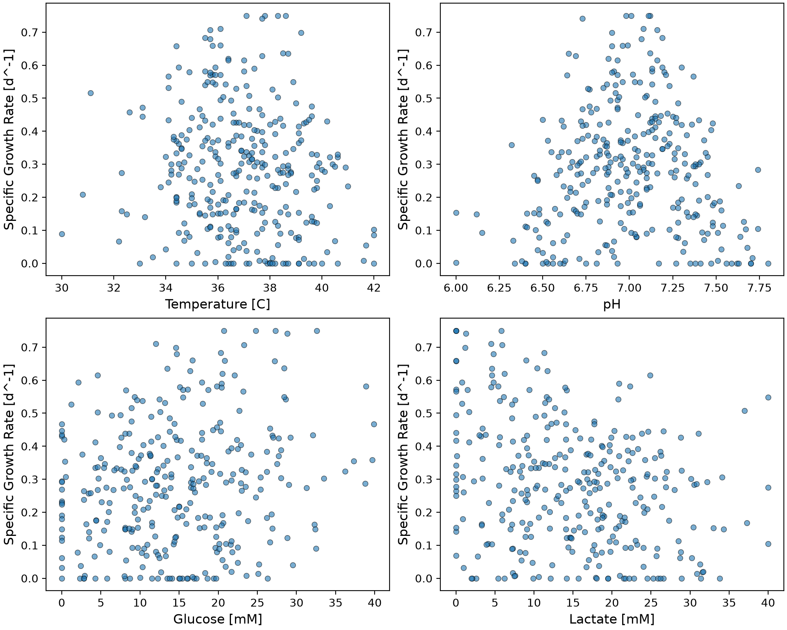

# Bioprocess Cell Growth Predictor

## Bioprocess Cell Growth Predictor

The Bioprocess Cell Growth Predictor is an end-to-end Python machine learning pipeline that models and forecasts specific cell growth rates ($\text{d}^{-1}$) in mammalian cell bioreactors. By analyzing key operational process variables—temperature, pH, glucose concentration, and lactate concentration—the software quantifies nonlinear metabolic responses, predicts batch yield trajectories, and optimizes environmental setpoints. This system eliminates reliance on expensive, time-consuming empirical lab trials by providing fast, reproducible computational forecasting for biomanufacturing workflows.

---

## Highlights

* **Engineered** modular object-oriented Python architecture across dedicated data pipelines.
* **Preprocessed** industrial bioreactor datasets using automated standardization and train-test splits.
* **Trained** polynomial regression and k-nearest neighbors models with cross-validation.
* **Evaluated** model generalization performance through RMSE and $R^2$ error metrics.
* **Visualized** multivariable process effects, feature correlations, and bias-variance tradeoff curves.

---

## Environment

* **Python**: 3.11.0
* **matplotlib**: 3.8.2
* **numpy**: 1.26.2
* **pandas**: 2.1.4
* **scikit-learn**: 1.3.2
* **seaborn**: 0.13.0

---

## Code Design

### Workflow Architecture Overview

Execution begins when `main.py` is called. The program follows a sequential, modular pipeline designed around separation of concerns: core constants and paths are initialized from `src/constants.py`, custom data structures and predictor wrappers are loaded from `src/classes.py`, and computational routines are imported from `src/functions.py`. The overall execution flow is organized into four main stages: configuration and object instantiation, data loading and preprocessing, model training and hyperparameter optimization, and output generation with figure/table export.

---

### Stage 1: Object Instantiation and Operational Parameter Calculation

#### What does this stage do?
This stage initializes operational bioreactor parameters using helper functions (`sf.calculate_average`) and instantiates domain-specific objects such as the `Batch` class from `src/classes.py`. Optimal pH and temperature target limits defined in `src/constants.py` are processed to log initial operational conditions.

#### Why is this stage necessary?
Establishing explicit batch metadata and operational baselines ensures system traceability. In industrial biomanufacturing, models must maintain context regarding target operational windows ($\text{pH} \approx 7.0$, $\text{Temperature} \approx 36.0\,^\circ\text{C}$) to contextualize downstream predictions.

#### How does this stage contribute to the overall workflow?
It acts as the system setup phase, verifying that configurations and class definitions are properly linked prior to computationally intensive data processing and model fitting.

---

### Stage 2: Data Ingestion, Extraction, and Preprocessing

#### What does this stage do?
The program checks for the existence of `cell_growth_data.csv` using robust path resolution. The function `sf.load_cell_growth_data` parses the dataset into a 2D NumPy feature matrix ($X$) comprising Temperature, pH, Glucose, and Lactate, and a 1D target array ($y$) containing the Specific Growth Rate. A train-test split (`train_test_split`) divides the dataset into an 80% training set and a 20% independent testing set using a fixed random seed.

#### Why is this stage necessary?
Data loading converts raw tabular files into structured matrices suitable for linear algebra and machine learning operations. Separating training and testing partitions prevents data leakage, enabling unbiased evaluation of how models generalize to unseen bioreactor runs.

#### How does this stage contribute to the overall workflow?
It establishes the standard data arrays that feed directly into all model fitting and cross-validation subroutines.

---

### Stage 3: Feature Pipeline Construction, Model Fitting, and Hyperparameter Optimization

#### What does this stage do?
This stage builds scikit-learn `Pipeline` objects combining `StandardScaler` with regression models. Models evaluated include:
1. Standard Linear Regression baseline.
2. Polynomial Regression across degrees 1 to 4 via `PolynomialFeatures`.
3. $k$-Nearest Neighbors ($k\text{NN}$) Regression optimized using `GridSearchCV` across neighbor values $k \in [3, 5, 7, 9, 11, 15, 21]$ and weighting strategies (`uniform` vs. `distance`).

Each pipeline is wrapped in a `CellGrowthPredictor` object, which encapsulates `fit`, `predict`, and evaluation functions (`sf.evaluate_model`).

#### Why is this stage necessary?
Bioprocess variables operate on vastly different scales ($\text{pH} \approx 6-8$ vs. $\text{Glucose} \approx 0-40\,\text{mM}$). Feature scaling via `StandardScaler` is required to ensure distance metrics in $k\text{NN}$ and gradient updates in linear models treat all inputs equally. Hyperparameter optimization identifies optimal model complexity without underfitting or overfitting.

#### How does this stage contribute to the overall workflow?
It trains and tunes candidate model architectures, producing trained estimators capable of generating predictions for evaluation.

---

### Stage 4: Performance Evaluation, Visualization, and Artifact Export

#### What does this stage do?
The final stage computes Root Mean Squared Error (RMSE) and Coefficient of Determination ($R^2$) for training and testing splits across all algorithms. Export functions save performance tables to `tables/` as CSV files (`tables/table_polynomial_performance.csv`, `tables/table_knn_sweep.csv`, and `tables/table_best_model_comparison.csv`). Visualization functions generate high-resolution PNG plots saved to `figures/`, including feature correlation scatter plots, hyperparameter sweep curves, actual-vs-predicted parity plots, comparative bar charts, and 4-panel marginal effect curves.

#### Why is this stage necessary?
Quantitative metrics and visual diagnostics are required to compare candidate algorithms, verify linear model assumptions, inspect residual performance, and demonstrate model interpretability. Automatically exporting tables and figures ensures reproducible reporting.

#### How does this stage contribute to the overall workflow?
It transforms numerical model outputs into actionable visualizations and clean summary tables that form the foundation of the analytical evaluation.

---

## Analysis

### Justification of Model Architecture Selection

Developing a machine learning model for bioprocess prediction requires balancing predictive accuracy, computational complexity, and physical interpretability. In mammalian cell culture modeling, cellular growth responses to environmental factors (temperature and pH) and nutrient/metabolite dynamics (glucose and lactate) are fundamentally nonlinear. 

To determine the most appropriate model architecture, three primary model families were constructed and systematically evaluated:
1. **Standard Linear Regression** (Baseline)
2. **Polynomial Regression** (Degrees 1 through 4)
3. **$k$-Nearest Neighbors ($k\text{NN}$) Regression** (Hyperparameter sweeps across $k \in [3, 21]$ with uniform and distance weighting)

The **Degree 3 Polynomial Regression model** emerged as the superior architecture across all evaluation criteria. It achieved a **Test RMSE of $0.03977\,\text{d}^{-1}$** and a **Test $R^2$ of $0.9198$**, explaining over 91.9% of the variance in unseen test data.

---

### Comparative Analysis Against Alternatives

#### 1. Baseline Linear Regression vs. Polynomial Models
The Standard Linear Regression baseline exhibited severe underfitting. With a Test RMSE of $0.09133\,\text{d}^{-1}$ and a low Test $R^2$ of $0.5771$, a simple linear combination of input variables fails to capture the parabolic, temperature/pH-dependent growth optima or the asymptotic nutrient saturation behavior inherent to cell growth.

Introducing polynomial feature interactions dramatically improved performance. Increasing the polynomial degree from 1 to 2 reduced Test RMSE by 41.1% (from $0.09133$ to $0.05379\,\text{d}^{-1}$) and elevated Test $R^2$ from $0.5771$ to $0.8533$. Escalating to **Degree 3** further decreased Test RMSE to **$0.03977\,\text{d}^{-1}$** ($+91.98\%$ variance explained).

However, increasing to **Degree 4** triggered classic overfitting. While Training RMSE dropped to a near-zero $0.01061\,\text{d}^{-1}$ ($R^2 = 0.9948$), Test RMSE spiked by 48.2% to $0.05893\,\text{d}^{-1}$ ($R^2 = 0.8240$). This inflection point illustrates the bias-variance tradeoff: Degree 4 models fit high-frequency training noise, degrading generalization performance on unseen bioreactor data.

**Polynomial Performance Summary Table (`tables/table_polynomial_performance.csv`):**
| Model | Hyperparameters | Train RMSE [$\text{d}^{-1}$] | Test RMSE [$\text{d}^{-1}$] | Train $R^2$ | Test $R^2$ |
| :--- | :--- | :---: | :---: | :---: | :---: |
| Standard Linear Regression | None | 0.075247 | 0.091332 | 0.736223 | 0.577106 |
| Polynomial Regression (Deg 1) | Degree=1 | 0.075247 | 0.091332 | 0.736223 | 0.577106 |
| Polynomial Regression (Deg 2) | Degree=2 | 0.035890 | 0.053789 | 0.939992 | 0.853321 |
| **Polynomial Regression (Deg 3)** | **Degree=3** | **0.025047** | **0.039774** | **0.970774** | **0.919800** |
| Polynomial Regression (Deg 4) | Degree=4 | 0.010611 | 0.058927 | 0.994754 | 0.823957 |

**Figure: Polynomial Regression Complexity Curve**
`figures/figure_polynomial_complexity.png`

---

#### 2. $k$-Nearest Neighbors ($k\text{NN}$) Regression Sweep
To test non-parametric alternatives, hyperparameter sweeps were conducted across neighbor values $k \in [3, 21]$ using both `uniform` and `distance` weighting schemes.

**$k\text{NN}$ Sweep Summary Table (`tables/table_knn_sweep.csv`):**
| Model | Neighbors ($k$) | Weighting | Train RMSE [$\text{d}^{-1}$] | Test RMSE [$\text{d}^{-1}$] | Train $R^2$ | Test $R^2$ |
| :--- | :---: | :---: | :---: | :---: | :---: | :---: |
| $k\text{NN}$ Regression | 3 | uniform | 0.055708 | 0.091496 | 0.855424 | 0.575588 |
| $k\text{NN}$ Regression | 3 | distance | 0.000000 | 0.086858 | 1.000000 | 0.617525 |
| $k\text{NN}$ Regression | 5 | uniform | 0.060750 | 0.095419 | 0.828074 | 0.538411 |
| $k\text{NN}$ Regression | 5 | distance | 0.000000 | 0.090239 | 1.000000 | 0.587173 |
| $k\text{NN}$ Regression | 7 | uniform | 0.067684 | 0.083130 | 0.786582 | 0.649648 |
| $k\text{NN}$ Regression | 7 | distance | 0.000000 | 0.080019 | 1.000000 | 0.675382 |
| $k\text{NN}$ Regression | 9 | uniform | 0.070681 | 0.076725 | 0.767270 | 0.701557 |
| $k\text{NN}$ Regression | 9 | distance | 0.000000 | 0.074970 | 1.000000 | 0.715053 |
| $k\text{NN}$ Regression | 11 | uniform | 0.076364 | 0.077109 | 0.728338 | 0.698564 |
| $k\text{NN}$ Regression | 11 | distance | 0.000000 | 0.075058 | 1.000000 | 0.714389 |
| $k\text{NN}$ Regression | 15 | uniform | 0.086118 | 0.082912 | 0.654503 | 0.651487 |
| $k\text{NN}$ Regression | 15 | distance | 0.000000 | 0.079583 | 1.000000 | 0.678911 |
| $k\text{NN}$ Regression | 21 | uniform | 0.093575 | 0.086177 | 0.592082 | 0.623495 |
| $k\text{NN}$ Regression | 21 | distance | 0.000000 | 0.082564 | 1.000000 | 0.654408 |

**Figure: $k\text{NN}$ Regression Complexity Curve**
`figures/figure_knn_complexity.png`

While distance-weighted $k\text{NN}$ models achieved perfect training scores ($\text{Train RMSE} = 0.00000, \text{Train } R^2 = 1.0000$) because training samples receive infinite weight at zero distance, their best generalization performance peaked at $k=9$ ($\text{Test RMSE} = 0.07497\,\text{d}^{-1}, \text{Test } R^2 = 0.7151$). When using `GridSearchCV` cross-validation across folds, the optimal candidate selected was $k=3$ with distance weighting ($\text{Test RMSE} = 0.08686\,\text{d}^{-1}, \text{Test } R^2 = 0.6175$). Across all hyperparameter settings, $k\text{NN}$ struggled due to the curse of dimensionality and sparse sampling across 4D continuous process spaces.

---

#### 3. Summary Model Comparison
The table and bar chart below highlight the final comparison between the baseline model, the top non-parametric model, and the selected Degree 3 Polynomial model.

**Best Model Comparison Summary Table (`tables/table_best_model_comparison.csv`):**
| Model | Hyperparameters | Train RMSE [$\text{d}^{-1}$] | Test RMSE [$\text{d}^{-1}$] | Train $R^2$ | Test $R^2$ |
| :--- | :--- | :---: | :---: | :---: | :---: |
| Standard Linear Regression | None | 0.075247 | 0.091332 | 0.736223 | 0.577106 |
| **Polynomial Regression (Deg 3)** | **Degree=3** | **0.025047** | **0.039774** | **0.970774** | **0.919800** |
| Optimized $k\text{NN}$ Regression | $k=3$, weights=distance | 0.000000 | 0.086858 | 1.000000 | 0.617525 |

**Figure: Model Comparison Bar Chart**
`figures/figure_model_comparison_bar.png`

Parity plots further confirm the model fit: Degree 3 Polynomial predictions cluster tightly along the $y = y_{\text{pred}}$ ideal prediction line, whereas $k\text{NN}$ exhibits noticeable dispersion and prediction lag.

| Polynomial Regression Parity Plot | $k\text{NN}$ Regression Parity Plot |
| :---: | :---: |
| `figures/figure_actual_vs_predicted_polynomial_regression.png`  | `figures/figure_actual_vs_predicted_knn_regression.png`  |

---

### Biological Interpretability & Feature Analysis

Analyzing feature correlation scatter plots and 4-panel process variable response curves reveals the biological relationships captured by the Degree 3 Polynomial model.

| Exploratory Feature Correlations | Process Variable Response Curves |
| :---: | :---: |
| `figures/figure_feature_correlations.png`  | `figures/figure_process_variable_effects.png`  |

#### 1. Temperature Response
* **Biochemical Dynamics:** Temperature exhibits a classic bell-shaped enzymatic response curve. Growth rates peak around an optimal physiological setpoint ($\approx 36.5\,^\circ\text{C}$).
* **Lower Limits ($< 32.0\,^\circ\text{C}$):** Hypothermic conditions slow down metabolic kinetics, transport enzymes, and cellular division rates, reducing growth ($\mu < 0.25\,\text{d}^{-1}$).
* **Upper Limits ($> 39.0\,^\circ\text{C}$):** Hyperthermic conditions induce thermal denaturation of essential cellular proteins, triggering heat-shock responses and cell death ($\mu < 0.20\,\text{d}^{-1}$).

#### 2. pH Response
* **Biochemical Dynamics:** pH displays a narrow, highly sensitive quadratic optimum centered around $\text{pH} \approx 7.05$.
* **Acidic Extremes ($\text{pH} < 6.5$):** Extracellular acidity disrupts cell membrane potential, inhibits glycolysis, and forces cells to expend energy maintaining intracellular homeostasis rather than dividing.
* **Alkaline Extremes ($\text{pH} > 7.6$):** High pH leads to enzymatic inactivation and cellular toxicity, dropping predicted growth sharply toward zero.

#### 3. Glucose Concentration Response
* **Biochemical Dynamics:** Glucose acts as the primary carbon and energy source for cell growth, showing Monod-like saturation kinetics.
* **Low Glucose ($< 10\,\text{mM}$):** Nutrient limitation restricts ATP production via glycolysis, constraining cell growth ($\mu < 0.15\,\text{d}^{-1}$).
* **High Glucose ($> 25\,\text{mM}$):** Higher glucose concentrations increase specific growth rates up to an asymptotic plateau ($\mu \approx 0.50-0.55\,\text{d}^{-1}$). Further increases yield diminishing returns once nutrient transporters become fully saturated.

#### 4. Lactate Concentration Response
* **Biochemical Dynamics:** Lactate is a metabolic byproduct of overflow glycolysis that accumulates during cell culture and acts as an inhibitory metabolite.
* **Low Lactate ($< 10\,\text{mM}$):** Low accumulation preserves minimal osmotic stress, enabling high specific growth rates ($\mu > 0.40\,\text{d}^{-1}$).
* **High Lactate ($> 30\,\text{mM}$):** High lactate increases osmotic pressure, induces intracellular acidification, and inhibits key glycolytic enzymes (e.g., phosphofructokinase), reducing cell growth ($\mu < 0.30\,\text{d}^{-1}$).

---

### Characterization of Cell Culture Conditions

#### High Growth Rate Conditions ($\mu > 0.45\,\text{d}^{-1}$)
* **Temperature:** Tight physiological control between $36.0\,^\circ\text{C}$ and $37.0\,^\circ\text{C}$.
* **pH:** Maintained at physiological neutrality ($\text{pH } 7.0 - 7.1$).
* **Glucose:** Non-limiting concentration ($> 25\,\text{mM}$).
* **Lactate:** Kept low ($< 10\,\text{mM}$) through feed strategy management or perfusion culture.

#### Low Growth Rate Conditions ($\mu < 0.15\,\text{d}^{-1}$)
* **Temperature:** Extreme hypothermia ($< 30\,^\circ\text{C}$) or hyperthermia ($> 40\,^\circ\text{C}$).
* **pH:** Acidic ($\text{pH} < 6.3$) or alkaline ($\text{pH} > 7.7$) deviations.
* **Glucose:** Depleted nutrient conditions ($< 5\,\text{mM}$).
* **Lactate:** High metabolic byproduct accumulation ($> 35\,\text{mM}$).

#### Model Uncertainty & Extrapolation Limits
* **Extrapolation Beyond Boundaries:** Polynomial models are subject to divergence outside their training domain. Predictions for inputs such as $\text{Temperature} < 28\,^\circ\text{C}$, $\text{pH} > 8.2$, or $\text{Glucose} > 50\,\text{mM}$ should be treated with caution, as high-order polynomial terms can produce unphysical growth values.
* **Extreme Multi-Variable Stress:** When multiple environmental stresses coincide simultaneously (e.g., low glucose combined with high lactate and acidic pH), unmodeled higher-order biological interactions may cause actual cellular behavior to deviate from polynomial predictions.

---

### Model Advantages, Limitations, and Industrial Applications

#### Advantages
* **High Predictive Accuracy:** Explains 91.98% of growth variance on unseen test data ($\text{RMSE} = 0.03977\,\text{d}^{-1}$).
* **Computational Efficiency:** Polynomial evaluation executes rapidly ($< 1\,\text{ms}$ per batch prediction), enabling real-time deployment in automated control loops.
* **Smooth Interpretability:** Provides continuous, differentiable mathematical functions that integrate directly with optimization algorithms (e.g., gradient ascent) for setpoint determination.

#### Limitations
* **Extrapolation Risks:** High-order polynomial terms may produce non-monotonic artifacts when evaluated beyond the range of historical training data.
* **Lack of Mechanistic Constraints:** As an empirical model, it lacks hard-coded mass balance or metabolic pathway constraints (e.g., explicit flux balance analysis).

#### Industrial Applications & Bioprocess Deployment
1. **Automated Bioreactor Feeding Strategies:** Integrates into supervisory control systems to adjust glucose feed rates dynamically based on predicted growth trajectories and lactate accumulation rates.
2. **Quality by Design (QbD) & Design Space Definition:** Maps multi-parameter operational windows to define safe processing boundaries for regulatory compliance (e.g., FDA/EMA process validation).
3. **Digital Twin Integration:** Serves as a fast, light-weight predictive engine within digital twin frameworks for real-time batch forecasting, anomaly detection, and harvest time optimization in industrial biomanufacturing.