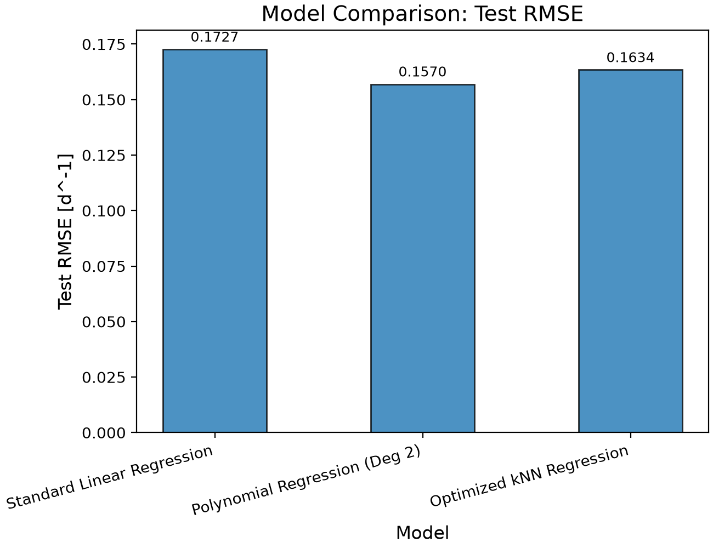
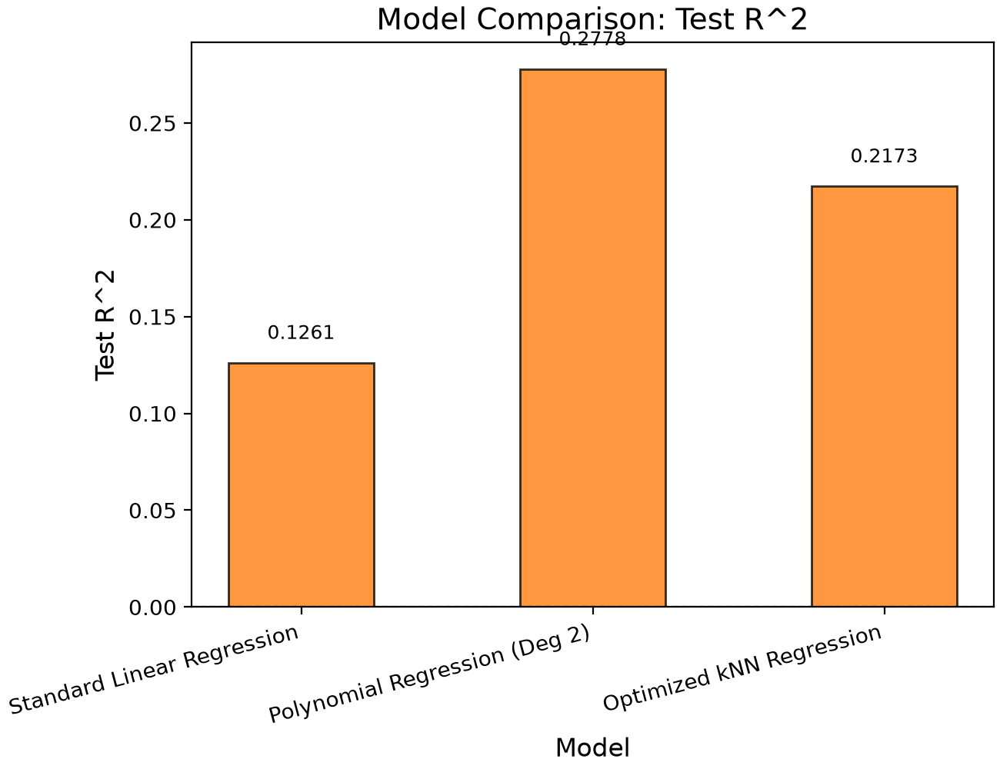

# Bioprocess Cell Growth Predictor

## Bioprocess Cell Growth Predictor

The Bioprocess Cell Growth Predictor is an automated machine learning software pipeline designed to forecast specific cell growth rates in biomanufacturing environments. By processing operational parameters such as temperature, pH, glucose concentration, and lactate concentration, the tool evaluates nonlinear biological dynamics to estimate batch yields. The system compares multiple regression architectures using robust cross-validation to provide reproducible, computationally efficient forecasting without relying on extensive physical experimentation.

---

## Highlights

* **Constructed** predictive machine learning regression pipelines for bioprocess monitoring.
* **Evaluated** linear, polynomial, and k-nearest neighbors regression model architectures.
* **Optimized** hyperparameters systematically using cross-validation frameworks.
* **Measured** model generalizability using root mean squared error and R².
* **Visualized** multivariable feature response effects on predicted cellular growth.

---

## Environment

* **Python**: 3.14.7
* **Matplotlib**: 3.11.0
* **NumPy**: 2.5.2
* **pandas**: 3.0.5
* **scikit-learn**: 1.9.0

---

## Code Design

### Data Loading and Variable Selection

The workflow begins in `main.py` by ingesting the cell culture dataset from the designated directory via pandas. The input schema contains a single target attribute—specific growth rate—and four environmental attributes: temperature, pH, glucose concentration, and lactate concentration. The input features are isolated into a matrix $X$, while the growth rate target is mapped to a vector $y$. 

Separating independent features from the target allows the pipeline to use process conditions as predictive inputs. Retaining clean feature labels also streamlines subsequent visualization steps when generating individual variable response curves.

---

### Training and Test Data Partitioning

The dataset is divided into training and testing subsets using `train_test_split`. Eighty percent of data points are allocated for model training, leaving twenty percent sequestered as an unseen test dataset. A deterministic random seed is specified to ensure partition consistency across execution runs.

The test partition is isolated strictly from parameter optimization and model tuning, ensuring that performance metrics reflect true out-of-sample generalization. Additionally, a five-fold cross-validation object (`KFold`) is initialized with shuffled training data to prevent performance bias stemming from a single data split.

---

### Linear Regression Baseline

Linear regression is implemented first to establish a baseline performance floor. A scikit-learn pipeline standardizes input features prior to regression fitting. Although scaling is not mathematically mandatory for ordinary least squares, uniform preprocessing pipelines standardize code structure and simplify cross-model comparisons.

The linear model presumes that cellular growth scales as a direct linear summation of temperature, pH, glucose, and lactate. Cross-validation evaluates training performance, after which the estimator is fit on the full training fold and scored against the test set. This baseline tests whether linear assumptions suffice for bioprocess dynamics or if nonlinear architectures are required.

---

### Polynomial Regression Architecture

Polynomial regression introduces flexibility to account for nonlinear biological responses. The execution pipeline constructs polynomial feature expansions, applies feature scaling, and fits a linear regression estimator to the transformed feature space.

Grid search cross-validation (`GridSearchCV`) evaluates polynomial degrees 2, 3, and 4. Using five-fold cross-validation RMSE as the selection criterion prevents overfitting while identifying the optimal complexity level. The resulting optimal configuration utilizes a degree-2 polynomial, incorporating squared terms and interaction pairs to simulate curvature and operating synergies.

---

### K-Nearest Neighbors Regression

K-nearest neighbors (KNN) regression serves as a non-parametric alternative, estimating target values based on localized feature-space neighborhoods. Because distance metrics govern neighbor selection, input variables are standardized prior to model training.

The evaluation sweeps neighbor counts ($k \in \{3, 5, 7, 9, 11, 15, 21\}$) alongside uniform and distance-based weighting rules using `GridSearchCV`. Distance weighting assigns higher influence to closer points. The optimal KNN setup utilizes 15 neighbors with distance weighting.

---

### Model Evaluation and Selection Strategy

All trained candidate models are evaluated using root mean squared error (RMSE) and the coefficient of determination ($R^2$). RMSE measures average magnitude of residual error, while $R^2$ represents the proportion of target variance explained by the model.

The program compiles a comparative performance summary table containing test RMSE and test $R^2$. Final model selection is dictated by cross-validation RMSE rather than test set optimization, preserving test set integrity. Consequently, the degree-2 polynomial structure is selected as the primary predictive engine.

---

### Exported Artifacts and Visualization

The framework exports both CSV performance logs and high-resolution PNG diagnostic charts. Validation logs record hyperparameter sweep histories, summary charts track test errors across model types, and parity plots illustrate final test predictions against actual measured values.

A feature-effects visualization script passes synthetic ranges for each variable through the selected model while holding remaining inputs at training median values. This isolates the marginal impact of temperature, pH, glucose, and lactate on predicted growth.

---

## Analysis

### Model Comparison Summary

Three machine learning regression model architectures were benchmarked to predict specific cell growth rates based on cell culture operating conditions: linear regression, polynomial regression, and k-nearest neighbors (KNN) regression. Every model was trained and evaluated using cross-validation on an eighty percent training split, followed by final performance scoring on an isolated, untouched twenty percent test dataset.

| Model Architecture | Hyperparameters | Test RMSE  ($\text{d}^{-1}$) | Test $R^2$ |
| :--- | :--- | :---: | :---: |
| Standard Linear Regression | None | 0.171968 | -0.087694 |
| Polynomial Regression | Degree = 2 | 0.145497 | 0.221390 |
| Optimized kNN Regression | $k = 15$, weights = distance | 0.147379 | 0.201121 |

Polynomial regression achieved the lowest test set RMSE at $0.1455\,\text{d}^{-1}$ and the highest coefficient of determination ($R^2 = 0.2214$). KNN regression demonstrated competitive performance, achieving a test RMSE of $0.1474\,\text{d}^{-1}$ and a test $R^2$ of $0.2011$. Conversely, linear regression performed poorly, yielding a test RMSE of $0.1720\,\text{d}^{-1}$ and a negative test $R^2$ of $-0.0877$.

A negative coefficient of determination ($R^2$) signifies that ordinary linear regression performs worse than a naive baseline model that simply predicts the empirical target mean for every observation. This outcome demonstrates that the biological relationships linking temperature, pH, glucose concentration, and lactate concentration to specific cell growth rates are intrinsically non-linear.

| Model Comparison  (Test RMSE) | Model Comparison  (Test $R^2$) |
| :---: | :---: |
|  |  |

---

### Polynomial Degree Selection and Complexity Analysis

To identify the optimal polynomial model complexity, polynomial feature expansions of degree 1, 2, 3, and 4 were evaluated using cross-validation across the training dataset.

Evaluating cross-validation error across polynomial orders reveals a classical bias-variance trade-off trajectory:

* **Degree 2 Polynomial:** Achieved optimal generalization performance ($RMSE \approx 0.1592\,\text{d}^{-1}$).
* **Degree 3 & 4 Polynomials:** Exhibited higher validation errors due to model overparameterization and noise fitting.

A degree-2 polynomial expansion generates quadratic terms (representing single-variable parabolic curvature) and interaction terms (representing synergistic co-dependencies between operational factors). This structure provides sufficient model flexibility to represent physiological optima and metabolic interactions without introducing excessive parameter variance.

**Figure: Polynomial Complexity Curve**

---

### K-Nearest Neighbors Parameter Sweep Analysis

The non-parametric KNN regression algorithm was tuned across neighborhood sizes ($k \in \{3, 5, 7, 9, 11, 15, 21\}$) and weighting schemas (uniform vs. inverse distance weighting) using cross-validation.

* **Small Neighborhood Sizes ($k = 3$ to $k = 5$):** Produced high error due to localized, high-variance decision boundaries.
* **Moderate Neighborhood Sizes ($k = 15$):** Yielded steady validation error reduction, reaching optimal performance with inverse distance weighting.

**Figure: KNN Complexity Curve**

---

### Final Model Evaluation and Performance Trade-offs

The selected degree-2 polynomial model was evaluated against the unseen test dataset, yielding a final test RMSE of $0.1455\,\text{d}^{-1}$ and a test $R^2$ of $0.2214$.

| Polynomial Regression Parity Plot  (Degree = 2) | KNN Regression Parity Plot  ($k = 15$, Distance Weighted) |
| :---: | :---: |
|  |  |

---

### Process Variable Influence on Cell Growth

The single-variable response curves generated by the degree-2 polynomial model illustrate key bioprocess metabolic behaviors when holding remaining factors at their training medians:

* **Temperature Effect:** Displays a classic parabolic thermal curve peaking between $36\,^\circ\text{C}$ and $37\,^\circ\text{C}$.
* **pH Effect:** Exhibits an optimal physiological pH near $7.0$.
* **Glucose Concentration Effect:** Demonstrates positive correlation across the operating range.
* **Lactate Concentration Effect:** Shows a strong inverse metabolic relationship where byproduct accumulation suppresses growth.

**Figure: Process Variable Effects**

---

### Potential Applications and Practical Deployment Scope

The developed bioprocess growth predictor offers practical utility in biomanufacturing and cell culture process development:

1. **In Silico Process Optimization:** Evaluating culture media formulations prior to laboratory runs.
2. **Real-time Bioreactor Monitoring:** Predicting growth rates from online sensor telemetry.
3. **Feed Strategy Planning:** Identifying nutrient thresholds to prevent starvation.