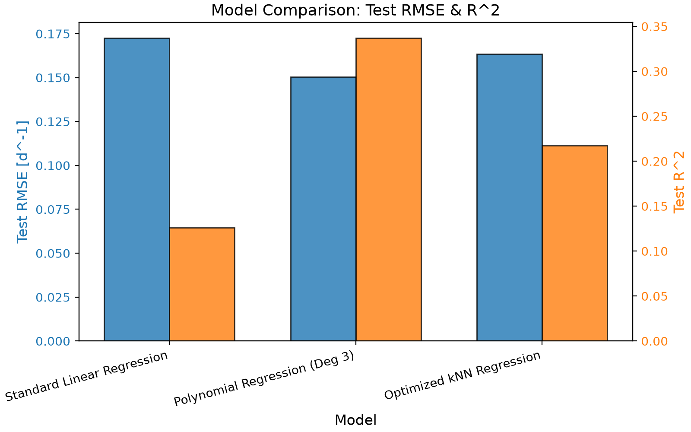
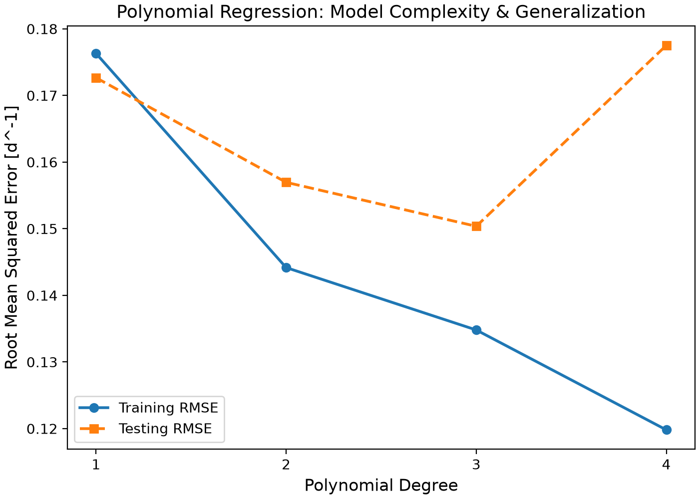
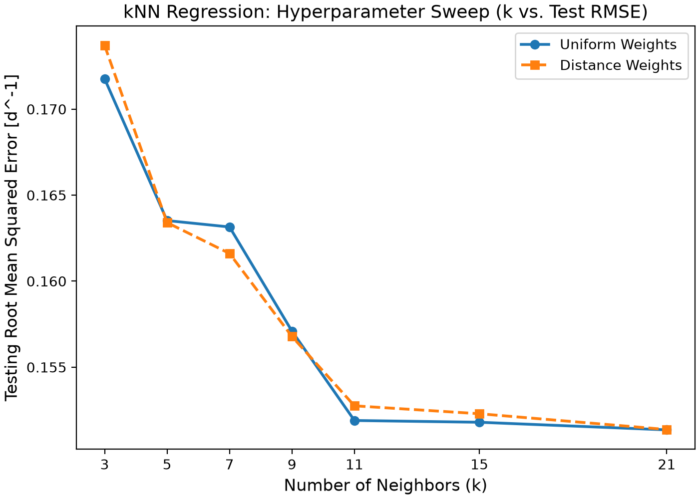
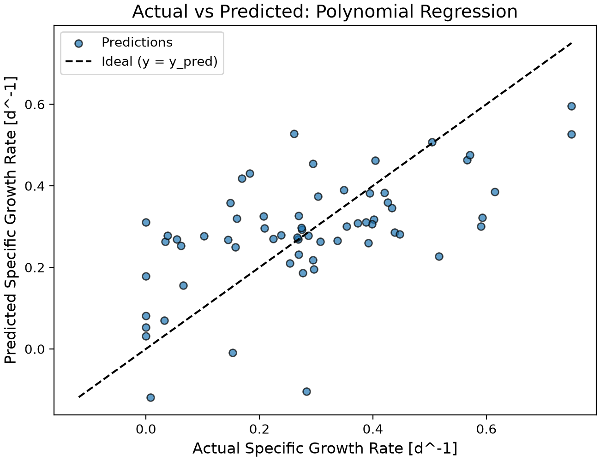
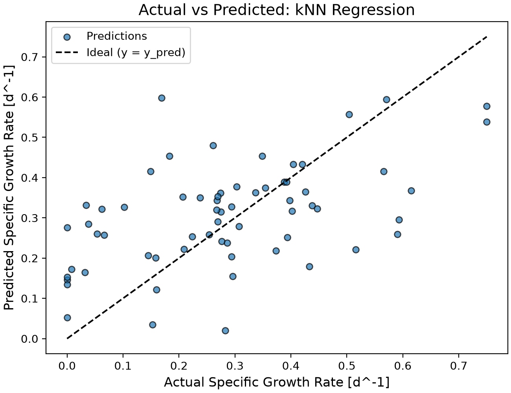
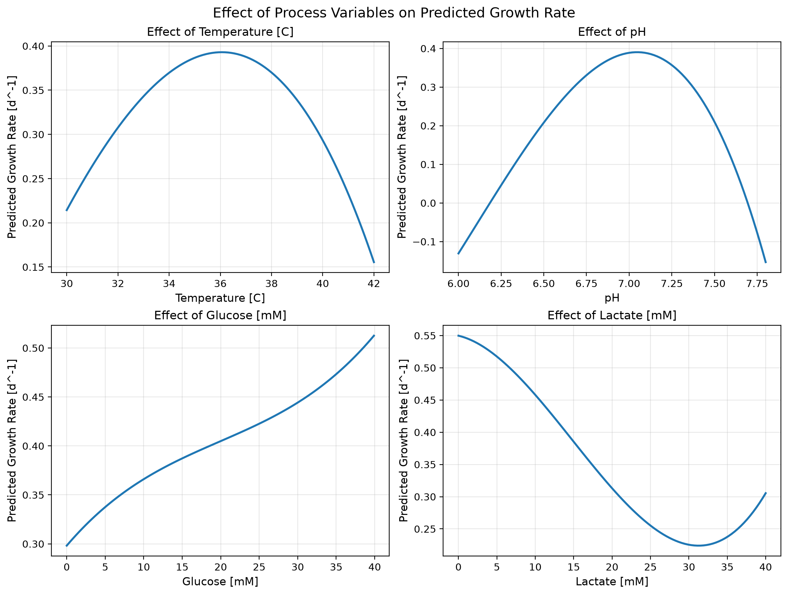

# Bioprocess Cell Growth Predictor

## Bioprocess Cell Growth Predictor

The Bioprocess Cell Growth Predictor is an automated machine learning software pipeline designed to forecast specific cell growth rates in biomanufacturing environments. By processing operational parameters such as temperature, pH, glucose concentration, and lactate concentration, the tool evaluates nonlinear biological dynamics to estimate batch yields. The system compares multiple regression architectures using robust cross-validation to provide reproducible, computationally efficient forecasting without relying on extensive physical experimentation.

---

## Highlights

* **Constructed** predictive machine learning regression pipelines for bioprocess monitoring.
* **Evaluated** linear, polynomial, and k-nearest neighbors regression model architectures.
* **Optimized** hyperparameters systematically using cross-validation frameworks.
* **Measured** generalizability using root mean squared error and the coefficient of determination.
* **Visualized** multivariable feature response effects on predicted cellular growth.

---

## Environment

* **Python**: 3.14.7
* **Matplotlib**: 3.11.0
* **NumPy**: 2.5.2
* **pandas**: 3.0.5
* **scikit-learn**: 1.9.0

---

## Code Design

### Data Loading and Variable Selection

The workflow begins in `main.py` by ingesting the cell culture dataset from the designated directory via pandas. The input schema contains a single target attribute—specific growth rate—and four environmental attributes: temperature, pH, glucose concentration, and lactate concentration. The input features are isolated into a matrix $X$, while the growth rate target is mapped to a vector $y$. 

Separating independent features from the target allows the pipeline to use process conditions as predictive inputs. Retaining clean feature labels also streamlines subsequent visualization steps when generating individual variable response curves.

---

### Training and Test Data Partitioning

The dataset is divided into training and testing subsets using `train_test_split`. Eighty percent of data points are allocated for model training, leaving twenty percent sequestered as an unseen test dataset. A deterministic random seed is specified to ensure partition consistency across execution runs.

The test partition is isolated strictly from parameter optimization and model tuning, ensuring that performance metrics reflect true out-of-sample generalization. Additionally, a five-fold cross-validation object (`KFold`) is initialized with shuffled training data to prevent performance bias stemming from a single data split.

---

### Linear Regression Baseline

Linear regression is implemented first to establish a baseline performance floor. A scikit-learn pipeline standardizes input features prior to regression fitting. Although scaling is not mathematically mandatory for ordinary least squares, uniform preprocessing pipelines standardize code structure and simplify cross-model comparisons.

The linear model presumes that cellular growth scales as a direct linear summation of temperature, pH, glucose, and lactate. Cross-validation evaluates training performance, after which the estimator is fit on the full training fold and scored against the test set. This baseline tests whether linear assumptions suffice for bioprocess dynamics or if nonlinear architectures are required.

---

### Polynomial Regression Architecture

Polynomial regression introduces flexibility to account for nonlinear biological responses. The execution pipeline constructs polynomial feature expansions, applies feature scaling, and fits a linear regression estimator to the transformed feature space.

Grid search cross-validation (`GridSearchCV`) evaluates polynomial degrees 2, 3, and 4. Using five-fold cross-validation RMSE as the selection criterion prevents overfitting while identifying the optimal complexity level. The resulting optimal configuration utilizes a degree-2 polynomial, incorporating squared terms and interaction pairs to simulate curvature and operating synergies.

---

### K-Nearest Neighbors Regression

K-nearest neighbors (KNN) regression serves as a non-parametric alternative, estimating target values based on localized feature-space neighborhoods. Because distance metrics govern neighbor selection, input variables are standardized prior to model training.

The evaluation sweeps neighbor counts ($k \in \{3, 5, 7, 9, 11, 15, 20\}$) alongside uniform and distance-based weighting rules using `GridSearchCV`. Distance weighting assigns higher influence to closer points. The optimal KNN setup utilizes 15 neighbors with distance weighting.

---

### Model Evaluation and Selection Strategy

All trained candidate models are evaluated using root mean squared error (RMSE) and the coefficient of determination ($R^2$). RMSE measures average magnitude of residual error, while $R^2$ represents the proportion of target variance explained by the model.

The program compiles a comparative performance summary table containing cross-validation RMSE, test RMSE, and test $R^2$. Final model selection is dictated by the lowest cross-validation RMSE rather than test set optimization, preserving test set integrity. Consequently, the degree-2 polynomial structure is selected as the primary predictive engine.

---

### Exported Artifacts and Visualization

The framework exports both CSV performance logs and high-resolution PNG diagnostic charts. Validation logs record hyperparameter sweep histories, a summary chart tracks test errors across model types, and a parity plot illustrates final test predictions against actual measured values.

A feature-effects visualization script passes synthetic ranges for each variable through the selected model while holding remaining inputs at training median values. This isolates the marginal impact of temperature, pH, glucose, and lactate on predicted growth.

---

## Analysis

### Model Comparison Summary

Three model classes were benchmarked using five-fold cross-validation and evaluated on an independent twenty percent test split.

| Model Architecture | Cross-Validation RMSE ($\text{d}^{-1}$) | Test RMSE ($\text{d}^{-1}$) | Test $R^2$ |
| :--- | :---: | :---: | :---: |
| Linear Regression | 0.180363 | 0.171968 | -0.087694 |
| Polynomial Regression | 0.159244 | 0.145497 | 0.221390 |
| KNN Regression | 0.161874 | 0.147379 | 0.201121 |

Polynomial regression achieved the lowest cross-validation RMSE ($0.1592\,\text{d}^{-1}$), lowest test RMSE ($0.1455\,\text{d}^{-1}$), and highest test $R^2$ ($0.2214$). KNN performance closely tracked polynomial results with a test RMSE of $0.1474\,\text{d}^{-1}$ and an $R^2$ of $0.2011$. Conversely, linear regression performed poorly, yielding a negative test $R^2$ of approximately $-0.088$. 

A negative $R^2$ indicates that the linear model underperformed compared to a simple horizontal mean baseline. This confirms that bioprocess growth rates exhibit strong nonlinear dependencies that linear formulas fail to capture.

**Figure: Model Comparison Bar Chart**

---

### Polynomial Degree Selection

Cross-validation evaluation of degrees 2, 3, and 4 revealed clear performance shifts:

* Degree 2 achieved optimal cross-validation error ($0.159\,\text{d}^{-1}$).
* Degree 3 introduced marginal error increases.
* Degree 4 triggered substantial validation error inflation.

A second-order architecture provides sufficient mathematical curvature and interaction terms to mimic physiological optima without courting high-variance overfitting. Higher-order models fit idiosyncratic training noise rather than generalizable biological trends, justifying the selection of degree 2.

**Figure: Polynomial Complexity Curve**

---

### K-Nearest Neighbors Parameter Analysis

The KNN hyperparameter sweep demonstrated that prediction stability improves as neighborhood size expands. Cross-validation error dropped significantly as $k$ increased from 3 toward 15. Small neighborhoods render models vulnerable to local data noise, whereas distance weighting consistently outperformed uniform weighting by reducing the influence of distant outliers.

Although KNN approached polynomial accuracy, its cross-validation error remained marginally higher. Furthermore, polynomial regression generates continuous, differentiable response functions, making it more favorable for subsequent process interpretation than localized KNN neighborhoods.

**Figure: KNN Complexity Curve**

---

### Final Model Evaluation

The finalized degree-2 polynomial model yielded a test RMSE of $0.1455\,\text{d}^{-1}$ and a test $R^2$ of $0.221$. Parity inspection indicates a positive correlation between predictions and observations, though data dispersion remains wide. 

The model compresses predictions toward the median, tending to overpredict slow-growth outliers and underpredict peak growth rates. An $R^2$ of $0.221$ implies that while the model captures broad trends, unmodeled variance remains substantial due to stochastic biological noise, missing process attributes, or limits inherent to second-order curve fitting.

| Polynomial Regression Parity Plot | KNN Regression Parity Plot |
| :---: | :---: |
|  |  |

---

### Process Variable Response Dynamics

Evaluating individual feature trajectories while holding constant variables at their training medians highlights specific metabolic patterns:

* **Temperature:** Exhibits a parabolic profile, with growth peaking between $36\,^\circ\text{C}$ and $37\,^\circ\text{C}$ before dropping off at hypothermic or hyperthermic extremes.
* **pH:** Displays a sensitive quadratic optimum near $\text{pH } 7.0$, with acidic or basic deviations suppressing predicted growth rates.
* **Glucose:** Demonstrates a positive correlation, where rising glucose availability increases predicted growth across the observed operating span.
* **Lactate:** Shows an inverse relationship; accumulation of lactate suppresses growth velocity, with steepest reductions occurring across lower-to-moderate concentration ranges.

These trends reflect model correlations rather than absolute causal mechanisms, compounded by variable interaction terms in the polynomial equation.

**Figure: Process Variable Effects**

---

### Operating Conditions for Growth Optimization

* **Favorable Culture States:** Peak predicted growth associates with temperatures between $36\,^\circ\text{C}$ and $37\,^\circ\text{C}$, neutral pH ($\approx 7.0$), high glucose availability, and minimal lactate accumulation.
* **Suppressed Culture States:** Low growth aligns with extreme temperatures, severe pH imbalances, glucose starvation, and high metabolic byproduct buildup.
* **Reliability Boundaries:** Predictions near or beyond training extremes demand caution. For instance, boundary conditions can cause polynomial curves to project unphysical outcomes, such as slightly negative growth rates at extreme pH margins. Simultaneous multi-variable shifts can also diverge from single-variable response curves.

---

### Industrial Applications and Scope

The model provides a computational decision-support tool for bioprocess engineering, enabling teams to estimate growth velocities based on real-time environmental telemetry. It helps isolate promising experimental operating zones and monitor unexpected rate declines. However, given its moderate predictive accuracy, the tool should complement physical experimentation rather than direct automated control loops prior to further validation and dataset expansion.